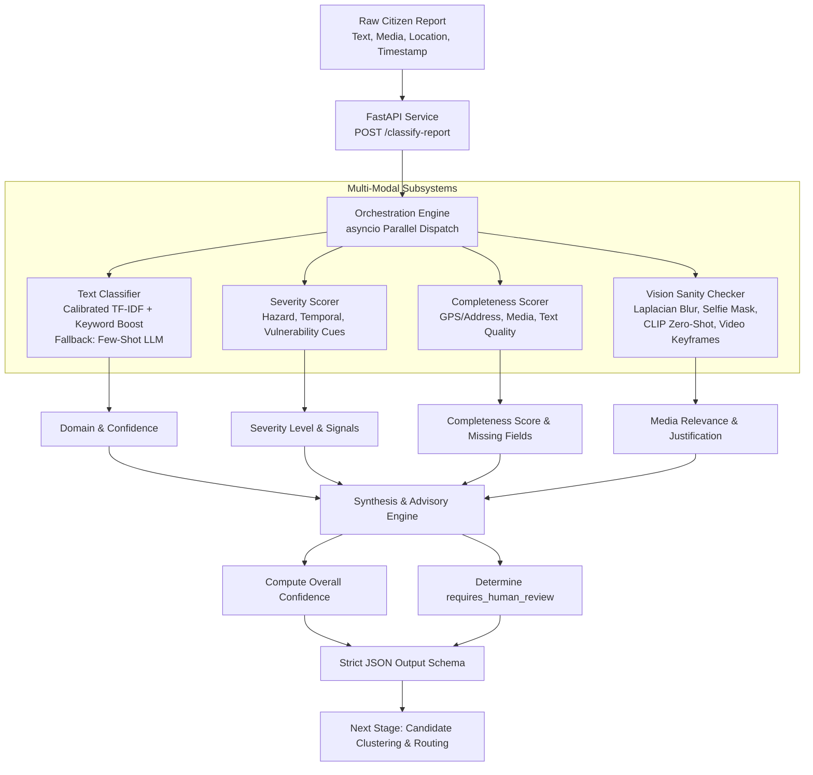

# Report Structuring & Classification AI (SIH 2026)

> **First-Stage Intelligence Engine for Civic Problem Ingestion & Multi-Modal Triage**  
> Developed for the Smart India Hackathon (SIH 2026) Civic Intelligence Platform.

---

## 📌 Overview

Citizen complaints submitted through civic portals and mobile apps are notoriously unstructured, noisy, and heterogeneous: free-form natural language (often mixed English/Hindi/Hinglish), optional shaky camera photos or videos, imprecise or missing location tags, and varying levels of urgency.

The **Report Structuring & Classification AI** is the **first stage** of the platform pipeline. It ingests raw, unvetted citizen submissions and transforms them into standardized, machine-readable records with:
1. **Domain Classification**: Configurable 8-domain civic taxonomy with confidence scores and alternate candidate rankings.
2. **Severity Assessment**: Multi-signal detection (duration, hazard cues, vulnerability, scale) mapping to `Low`, `Medium`, `High`, or `Critical`.
3. **Completeness Scoring**: Hybrid 0–1 score analyzing GPS precision, media presence, textual informativeness, and timestamp recency, coupled with actionable suggestions for the citizen.
4. **Multi-Modal Vision Sanity-Checking**: Zero-shot vision domain consistency verification (CLIP-style), blur detection (Laplacian variance), selfie/unrelated image filtering, and video keyframe sampling.
5. **Advisory Decision Support**: AI outputs are advisory only; reports are never auto-rejected. The `requires_human_review` flag defaults to `true` on low confidence, media mismatch, or emergency hazards.

---

## 🏛️ Architecture & Pipeline Flow



---

## 📂 Project Structure

```
d:\sih2026 model\
├── config/
│   ├── taxonomy.yaml               # Extensible civic taxonomy (8 categories + prompts)
│   └── settings.py                 # Configuration, thresholds, and paths
├── data/
│   ├── synthetic_reports.json      # 260 labeled civic complaints across 8 domains
│   └── demo_assets/                # Sample images & video for testing & live jury demo
├── src/
│   ├── text_classifier/            # Calibrated offline classifier & training pipeline
│   ├── severity_scorer/            # Hybrid rule + pattern cue extractor
│   ├── completeness_scorer/        # GPS, media, text, timestamp evaluation
│   ├── vision_checker/             # OpenCV blur/selfie filter & zero-shot domain matching
│   ├── orchestrator/               # Multi-modal async orchestration & schema synthesis
│   └── api/                        # FastAPI service with multipart & JSON endpoints
├── ui/                             # Modern dark-mode Glassmorphic Web Dashboard
│   ├── index.html
│   ├── styles.css
│   └── app.js
├── tests/                          # Full pytest test suite (100% passing)
│   ├── test_text_classifier.py
│   ├── test_severity_scorer.py
│   ├── test_completeness_scorer.py
│   ├── test_vision_checker.py
│   ├── test_orchestrator.py
│   └── test_api_e2e.py
├── scripts/
│   ├── generate_synthetic_data.py  # Dataset generator
│   ├── create_demo_assets.py       # Visual asset generator
│   └── run_demo.py                 # One-command server runner
├── requirements.txt
└── README.md
```

---

## 🎯 Configurable Civic Taxonomy

Categories are defined in `config/taxonomy.yaml` and can be edited without code changes:
1. **Water Supply**: Pipeline leaks, overhead tank overflow, dry borewells, contamination, dirty tap water.
2. **Electricity**: Power outages, sparking transformers, dangling live wires, broken poles, voltage spikes.
3. **Roads & Infrastructure**: Craters/potholes, collapsed culverts/bridges, waterlogging, damaged dividers.
4. **Sanitation & Waste**: Overflowing koodadan/dustbins, open sewage drains, animal waste, burning trash.
5. **Public Health**: Dengue/malaria stagnant water pools, PHC medicine shortage, dead animal disposal.
6. **Education Infrastructure**: Dilapidated school roofs, collapsed boundary walls, broken desks, no toilets.
7. **Public Safety**: Dark unlit streets, open uncovered manholes, aggressive stray dog packs.
8. **Other**: Noise pollution, illegal hoardings, administrative delays.

---

## 🧪 5 Live Demo Scenarios (Jury Ready)

| # | Scenario Title | Description | Domain | Severity | Media Consistency | Human Review? |
|---|----------------|-------------|--------|----------|-------------------|---------------|
| 1 | **Flagship: Overhead Tank Overflow** | Repeated tank overflow in Ward 4, Morabadi with photo & GPS for 3 days. | Water Supply | High | Match ✅ | No (Ready for routing) |
| 2 | **Critical Hazard: 11kV Sparking Wire** | Snapped high-tension wire sparking in front of school gate. | Electricity | Critical | Match ✅ | Yes (Immediate field triage) |
| 3 | **Media Mismatch: Pothole with Selfie** | Road pothole complaint with an unrelated selfie uploaded. | Roads & Inf. | High | Mismatch ⚠️ | Yes (Staff verification) |
| 4 | **Vague & Incomplete: "bad road"** | Only 2 words, no photo, vague location ("my area"), no timestamp. | Roads & Inf. | Low | None ⚪ | Yes (Info prompt to citizen) |
| 5 | **Sanitation Crisis: Hospital Waste** | Illegal rotting medical waste dump opposite Sadar Hospital. | Sanitation | High | Match ✅ | No (Routed to Municipal Ward) |

---

## 📋 Strict JSON Output Schema

```json
{
  "report_id": "REP-1788632000-A9F21B",
  "domain_classification": {
    "category": "Water Supply",
    "confidence": 0.942,
    "alternate_categories": [
      { "category": "Sanitation & Waste", "confidence": 0.038 },
      { "category": "Roads & Infrastructure", "confidence": 0.015 }
    ]
  },
  "severity": {
    "level": "High",
    "confidence": 0.885,
    "signals": [
      "Sewage/water inundating residential living spaces ('entering houses')",
      "Persistent duration: 3 days"
    ]
  },
  "completeness": {
    "score": 0.95,
    "missing_fields": [],
    "suggestions_for_citizen": []
  },
  "media_relevance": {
    "provided": true,
    "match": true,
    "confidence": 0.88,
    "justification": "Image exhibits water-related visual features (fluid specular patterns, tank/pipe structural geometry) matching Water Supply complaint.",
    "frames_checked": 1
  },
  "requires_human_review": false,
  "overall_confidence": 0.892,
  "processing_metadata": {
    "model_versions": {
      "text_classifier": "TFIDF-LogisticCalibrated-v1.0",
      "vision_checker": "OpenCV-Heuristic-CLIP-v1.0",
      "severity_scorer": "SignalRegex-Hybrid-v1.0",
      "completeness_scorer": "WeightedRule-v1.0"
    },
    "processing_time_ms": 18.42,
    "offline_mode_used": true
  }
}
```

---

## 🚀 Quickstart & Running Locally

### 1. Install Dependencies
```bash
pip install -r requirements.txt
```

### 2. Run Test Suite
```bash
pytest tests/ -v
```
All unit tests and end-to-end API tests will run.

### 3. Launch Live Demo Service
```bash
python scripts/run_demo.py
```
Open your browser to:
- **Interactive UI Dashboard**: [http://127.0.0.1:8000](http://127.0.0.1:8000)
- **Interactive Swagger Docs**: [http://127.0.0.1:8000/docs](http://127.0.0.1:8000/docs)

---

## 🔌 Integration with Next Pipeline Stages

This module outputs standardized JSON and passes it forward:
1. **Stage 2 (Clustering & Deduplication)**: Uses `domain_classification.category` + GPS coordinates + timestamp window to group duplicate complaints into a single master ticket.
2. **Stage 3 (Departmental Capability Routing)**: Uses `severity.level` and `domain_classification` to dispatch field engineers or escalate emergencies.

---

## ⚠️ Known Limitations & Design Principles
- **Synthetic Data**: Trained on 260 curated complaints representing Jharkhand/Indian civic situations. In production, fine-tuning on historical municipal datasets is recommended.
- **Languages Supported**: Primary English and Hinglish/Hindi keywords (*paani, bijli, sadak, naali, kooda, gaddha*).
- **Advisory Principle**: Never auto-closes or rejects reports. AI provides prioritization assistance for human officials.
